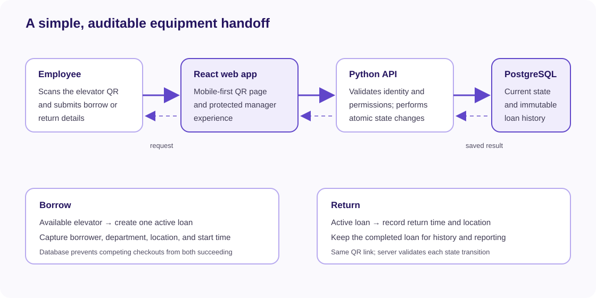

# Tool Planner: product and technical analysis

**Status:** Product scope confirmed; implementation in progress
**Implementation status:** Initial application foundation and core flows underway
**Last reviewed:** 2026-11-15

## Purpose

Plan an internal web application for borrowing and returning mobile elevators
and making future-dated reservations. Immediate checkout is the default. A
person scans an elevator's QR code, enters their name and where the elevator is
going, and submits a request. The system records the handover and makes the
elevator unavailable to others until it is returned. Admins maintain the
inventory, locations, and QR codes, and review usage history and reports.

This document is a proposal for discussion, not an approved specification.
Decisions that affect identity, access, return behavior, and deployment are
called out in [open questions](open-questions.md).
Detailed API, database, security, and deployment design is in
[solution-design.md](solution-design.md).
The implemented report dashboard, including visual previews and metric
definitions, is documented in [phase-4-reports-proposal.md](phase-4-reports-proposal.md).

## At a glance

## Goals and boundaries

### Goals

- Make it quick to see whether a specific elevator is available.
- Prevent two people from borrowing the same elevator at the same time.
- Record who borrowed which elevator, where it went, and when it was returned.
- Support immediate checkout by default and future-dated reservations in the
  first release.
- Let admins administer elevators and investigate long or unusual usage.
- Be usable on a phone from a QR scan, as well as on a desktop management page.
- Run as a containerized service with PostgreSQL and be deployable to Kubernetes.
- Keep operational history and personal data intentionally limited and auditable.

### Initial scope

- One Sanofi site, with configurable locations and departments.
- A fixed inventory of named elevators, each with a unique registration number.
- Immediate borrowing by a typed name (the default flow) and future-dated
  reservations; return by any authenticated user account.
- An authenticated admin area for inventory, configuration, and reports.
- Usage event history, basic CSV export, and operational dashboards.

Reservation duration, overlap, cancellation, expiry, and no-show settings are
admin-configurable; initial timing values are documented in the reservation
workflow below.

### Not planned for the initial site

- Multiple sites or external users.
- Approval workflows.
- Live GPS tracking, elevator telemetry, maintenance work orders, or integrations.
- Tracking an individual elevator's physical movements while it is on loan.

Multi-site support is not in scope. Avoid adding other capabilities until an
operational need is confirmed.

## Suggested user experience

### Borrow

1. The user scans a QR code affixed to an elevator. The link opens a mobile-first
   page identifying the elevator by a human-readable name and registration
   number.
2. The page shows its availability and, if already checked out, a safe,
   minimal indication that it is unavailable. Do not expose another user's
   personal details on the public page.
3. If available, the user supplies their typed name, approved department, and
   destination or current location, then confirms borrowing. Typed name is
   accepted but is not identity verification.
4. The user signs in with an application-managed account before submitting.
   The server records that account as the actor and atomically changes the
   elevator from available to checked out. Keep the entered borrower display
   name and department snapshot distinct from the account that submitted the
   checkout. A successful response shows the borrower, start time, and return
   instructions.
5. If another user has claimed it first, show a clear conflict and do not create
   a second outstanding custody record.

### Future reservation

- The QR page defaults to immediate checkout and offers a future reservation
  option with a requested start and end time.
- A confirmed reservation is separate from an active loan. Scanning the QR code
  at pickup converts the reservation into an active loan; returning the
  elevator closes the loan as usual.
- The scheduler must prevent overlapping reservations for the same elevator
  and account for active loans. An elevator with an active loan may still be
  reserved; the reservation is at risk until the current loan is returned.
- If an active loan has not been returned when a reservation starts, show an
  in-app alert to the reservation user and suggest other elevators that are
  available for the requested period. Do not silently substitute or cancel
  their reservation.
- Cancellation, expiry, no-show, and any minimum notice or maximum duration
  are configurable by admins. Initially set minimum notice, maximum duration,
  cancellation cutoff, and no-show grace period to seven days each.
- Since minimum notice and cancellation cutoff are both seven days, a
  reservation made at the minimum notice will not be cancellable. Make this
  restriction clear in the user experience; admins can adjust either setting.
- If no alternative elevator is available, show an alert that the reserved
  elevator is not available.

### Return

1. Any authenticated user account scans the same QR code and can initiate the
   return; that account is recorded as the return actor, separately from the
   borrower.
2. If the elevator has an outstanding custody record, the page provides a
   return action, including when an admin has cancelled the loan because the
   elevator was blocked. The return records the actual return time and physical
   return location. If no different location is selected, it returns to the
   configured default location.
3. The page confirms the return and displays the updated availability.

The configured default physical location and the available custodian label are
separate concepts. When an elevator is not borrowed, show "Site" as its
available custodian; do not model that label as a person or location.

## Roles and access

| Role | Capabilities |
| --- | --- |
| User | Sign in with an application account; view elevator status; borrow and return elevators; submit a borrower display name |
| Admin | User capabilities plus manage users, elevators, locations, departments, reservation rules, blocked status, and reports |

There is no identity provider. Admins create user accounts with a username,
initial password, and role; the account also has a display name and department.
Support `user` and `admin` roles. Require a password change at first login.
All admins can manage users, elevators, reservation settings, and person-level
history/exports. Keep at least two designated admin accounts. Passwords must be
stored as strong one-way hashes, never in plaintext; the system must not reveal
an existing password to an admin. Provide a separate script that an admin runs
manually to create the initial admin accounts; prompt for credentials securely,
create at least two admins, and do not include default credentials in the
application image or source.

## Domain model and data to capture

Use stable database IDs; registration number is a unique human-facing identifier,
not the primary key. Store timestamps in UTC and render them in the site's
configured time zone.

| Entity | Initial fields and purpose |
| --- | --- |
| Elevator | ID, name, unique registration number, optional description, status (active/blocked/retired), block reason, QR token, created/updated timestamps. Seed the first elevator as `LIFT-001`. |
| Location | ID, name, optional area, active flag, and default flag; admins configure the one default physical location. Seed `Geel` as the initial default. |
| User account | ID, unique username, password hash, role, display name, department, active/disabled status, created/updated timestamps; admin-created |
| Department | ID, name or code, active flag; seed `Sites & Facilities` |
| Loan | ID, elevator, borrower account and display-name/department snapshots, checkout location, intended destination/current location, checkout timestamp, return timestamp, return location, return actor account, status, cancellation timestamp/actor/reason |
| Reservation | ID, elevator, requester account and display-name snapshot, requested start/end window, status, creation/completion/cancellation timestamps, linked loan when picked up, and policy settings/version applied |
| Audit event | Actor, action, entity, timestamp, outcome, reason, and minimal before/after metadata; corrections append a new event and preserve original values |
| Reservation settings | Admin-managed minimum notice, maximum duration, cancellation cutoff, expiry/no-show grace period, and related reservation rules |

Loan statuses are `active`, `cancelled`, and `returned`; a cancelled loan
remains an outstanding custody record until the physical return is recorded.
Elevator availability derives from outstanding custody and elevator status.
Admins can mark an elevator active,
blocked/unavailable, or retired. Blocking an elevator with an active loan
cancels that loan administratively with an actor, time, and reason. Cancellation
does not mean the elevator was physically returned: keep the borrower recorded
as custodian until the actual return is scanned and recorded. A blocked elevator
cannot be checked out or newly reserved. Admins must provide a reason when
blocking or unblocking it; changes are audited. Database constraints should
prevent multiple outstanding custody records for one elevator and overlapping
future reservations. Preserve history when an elevator is retired; do not
hard-delete historical records.

### Data quality and privacy

- Capture the borrower's department and destination at checkout as snapshots so
  later edits to configuration do not rewrite history.
- Capture a return location if elevators can be returned somewhere other than
  the default location.
- Store the current physical location separately from the active borrower.
  Exactly one active location is configurable as the default; changing it must
  not rewrite historical checkout or return locations.
- Distinguish an unknown value from "Site"; do not silently substitute the
  configured default location for a missing destination.
- Run an automated retention task daily. Delete eligible completed loans,
  reservations, and associated personal data once three years have elapsed
  since their completion/return; delete audit events once three years have
  elapsed since the event. Delete disabled user-account details three years
  after disablement when no outstanding custody record or unfulfilled
  reservation requires the account. Retain outstanding custody records and
  unfulfilled reservations.
- Backups may contain older records until their own lifecycle expires. After a
  restore, run retention cleanup before resuming normal access. Log and monitor
  cleanup outcomes.
- Restrict person-level report access; aggregate by default and expose
  individual details only for approved operational needs.
- Do not collect phone numbers, GPS, or other personal data without a confirmed
  operational need and policy approval.

## Core rules and edge cases

- A QR code identifies an elevator through a high-entropy, non-sequential token;
  it should not reveal a database ID or grant manager privileges.
- Reprinting a QR code should not change its link. Provide token rotation for a
  damaged, copied, or disclosed code; invalidate the previous token.
- Claiming and returning are server-side state transitions, not client-side
  toggles. Enforce availability transactionally in PostgreSQL.
- A repeated submission must not create duplicate custody records. Use an idempotency
  mechanism or safely detect retries.
- Only an outstanding custody record without a return timestamp can be returned;
  this includes an administratively cancelled loan. Handle stale pages and
  competing returns with a clear conflict response.
- Retiring an elevator prevents new loans without deleting its past loans.
- Store event times from the server clock. Consider an overdue threshold only
  after the business defines expected borrowing duration and escalation.
- Report loan age without an overdue label until operations selects a threshold.
- Provide an admin correction path for wrong borrower, location, or return
  time. Append the correction with actor and reason; preserve the original values.
- A future reservation must use a start/end window and prevent overlapping
  reservations for the same elevator. Allow reservations while an elevator is
  on loan, but alert the reservation user if the loan is still active at pickup
  and suggest other available elevators.
- Admins configure reservation limits and cancellation/expiry/no-show behavior.
- Blocking an elevator with an active loan administratively cancels the loan
  but does not imply physical return. Keep the borrower as custodian until the
  return is actually recorded. Blocking/unblocking and reasons are audited.
- When an admin blocks an elevator with future reservations, alert each
  reservation owner in the application on their next login. Suggest another
  available elevator when possible; otherwise show that the reserved elevator
  is not available. Email notifications may be added later.
- User creation, role changes, disablement, and password resets are admin-only
  and audited. Password reset must set a new password without exposing the old
  one; a newly assigned initial password must be changed at first login.

## Reports that become useful over time

Begin with operational views and add trend analysis as data quality improves:

- Current inventory: available, checked out, blocked, retired, and status by
  location.
- Active loans and loan age; do not label loans overdue until operations chooses
  a threshold.
- Checkout count and total/median loan duration by elevator, department,
  location, and time period.
- Peak demand by day of week/time and average time unavailable.
- Frequently used versus rarely used elevators; potential fleet rebalancing.
- Return-location patterns and unusually long loans, with overdue labels only
  after operations approves a threshold.
- Data quality: missing department/destination, corrected records, QR scans
  without a completed checkout (only if scan events are intentionally collected).

Define each report's filters, time zone, access policy, and denominator. Avoid
ranking or evaluating individual employees without a separately approved
purpose, notice, and governance. Do not treat scan counts as borrowing counts.

## Proposed architecture

- **Frontend:** React with TypeScript, responsive mobile-first public pages and
  a separate manager experience. Use accessible form controls and server-side
  authorization for every privileged action.
- **Backend:** Python with FastAPI, Pydantic request/response models, SQLAlchemy
  2.x, and Alembic migrations. Keep business rules in a service/domain layer
  rather than the HTTP handlers.
- **Database:** PostgreSQL. Use foreign keys, unique constraints, check
  constraints, indexes, and transaction-safe checkout/return operations.
- **Authentication:** Application-managed username/password accounts with
  `user` and `admin` roles. Admins create and manage accounts; all admins can
  view person-level history and exports. Keep at least two designated admins.
  Bootstrap at least two designated admins with initial passwords that must
  be changed at first login. Store only strong password hashes and protect
  login/session endpoints. QR codes identify elevators but do not grant access;
  sign-in is required to borrow, return, or perform management actions.
- **QR generation:** Generate a printable QR image containing the stable public
  elevator URL. QR rendering can happen in the backend or frontend; the token
  must be generated and validated by the backend.
- **Deployment:** Start from a clean deployment; do not depend on Sanofi's
  existing application/platform services. Provide Docker image build
  instructions and a Helm chart for Kubernetes deployment, including frontend
  and API workloads, configuration/secrets, resource requests/limits, probes,
  ingress, and database migration. PostgreSQL must be provisioned and backed
  up as part of the deployment design. Keep all environment-specific values
  configurable in Helm. Include a daily retention job and a manual bootstrap
  script for initial admin accounts.
- **Operations:** Structured logs without unnecessary personal data, metrics,
  health endpoints, backups with restore tests, TLS, and documented recovery.

Do not put database credentials, password material, or signing keys in images
or source control. Keep the database private to the application network. Apply
least privilege and non-root container defaults.

The initial user interface is English and should be tested on modern phones and
iPads. Recommended browser matrix: Safari on the current and previous major
iOS/iPadOS releases; Chrome on the current and previous major Android releases;
and current/previous Chrome, Edge, and Safari on desktop for admin pages. Use
`Europe/Brussels` for display, reservation input, and report grouping; store
timestamps in UTC and handle daylight-saving transitions.

## Sanofi-inspired visual direction

The public [Sanofi homepage](https://www.sanofi.com/) and [pipeline page](https://www.sanofi.com/en/our-science/our-pipeline)
were reviewed on 2026-11-15. The pages present a clean, editorial layout with
clear typography, generous spacing, prominent headings, and strong purple/violet
brand accents against light backgrounds. The proposed internal tool should use
a restrained interpretation: light neutral surfaces, purple primary actions,
high-contrast text, clear status colors, simple cards/tables, and responsive
layouts.

This is visual inspiration, not an official design specification. Confirm
approved colors, fonts, logo use, accessibility requirements, and internal
brand assets with Sanofi before implementation. Do not copy page layouts or use
the corporate logo without authorization. Validate color contrast and status
meaning independently of color.

## Quality attributes

- **Correctness:** one outstanding custody record maximum per elevator;
  immutable, timestamped history; explicit conflicts and validation errors.
- **Security:** authenticated admin operations, authorization checks on every
  request, secure secrets, rate limiting on public QR endpoints, and audit logs.
- **Usability:** phone-first QR flow, clear availability, short forms, keyboard
  support, understandable errors, and accessible contrast.
- **Reliability:** database backups, tested restoration, health probes, graceful
  shutdown, and database migration discipline.
- **Maintainability:** typed API contracts, migrations, focused modules, tests,
  documented setup, and repeatable local development.
- **Deployment:** reproducible container builds, non-root runtime, environment-
  based configuration, and Kubernetes resource/security defaults.

## Release acceptance criteria

The first release is ready for pilot when:

1. An admin can create, edit, retire, list, and print a QR code for an elevator.
2. A user can borrow an available elevator by scanning its code and submitting
   a typed name, approved department, and location fields.
3. A user can reserve an elevator for a future time window; conflicting
   reservations are rejected and pickup links the reservation to a loan.
4. If the elevator is still on loan at the reserved start time, the reservation
   user receives an alert and sees other elevators available for the requested
   period, when any are available.
5. Concurrent requests cannot create two outstanding custody records for the
   same elevator.
6. A valid return records the end time, changes availability, and preserves the
   complete loan history; any authenticated user account can return, and invalid or
   repeated returns fail safely.
7. Users must sign in to borrow/return; admins can search/filter inventory,
   inspect active loans, and export the
   approved basic history report; reports aggregate by default.
8. Admins can manage user accounts, roles, passwords, reservation settings
   (initially seven days for each configured time limit),
   blocked status, and default location. All admins can access person-level
   history and exports. Initial location is `Geel`; initial department is
   `Sites & Facilities`; the first elevator is `LIFT-001`. New passwords require
   a reset at first login. Blocking an elevator with an active loan cancels the
   loan record but keeps its borrower as custodian until actual return.
9. A daily, tested three-year cleanup task handles eligible records and reports
   its results; active loans and unfulfilled reservations are retained.
10. Automated tests, migrations, Docker image build, Helm deployment, backup/
   restore procedure, and operational runbook are verified.

Reservation time-window, cancellation, expiry, and no-show rules are
configurable by admins and covered by tests.

## Progress tracking

The [roadmap](roadmap.md) is the task tracker for this analysis and subsequent
delivery. It records major phases and minor steps with checkboxes and status.
Do not mark implementation tasks done until code, tests, and relevant review
evidence exist. Confirm or update the [open questions](open-questions.md) before
locking requirements.
