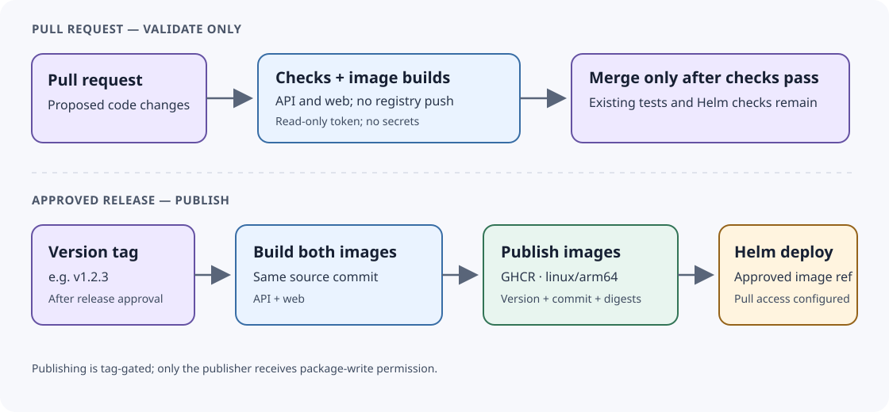

# Docker image CI and release proposal

**Status:** Implementation in progress; GHCR, release-tag, digest, and target
platform choices are confirmed.

## Summary

GitHub Actions can build both application images using the existing Dockerfiles.
The current CI already runs backend and frontend checks and validates the Helm
chart, but it does not build the API or web image. Add a Docker build check for
pull requests, then publish images only after an explicitly versioned release
event. The product owner selected GitHub Container Registry (GHCR), the
`vMAJOR.MINOR.PATCH` convention, version and commit-specific tags, digest
recording, digest-pinned deployments, and ARM64 images for the Turing RK1.

The recommendation is to keep image validation separate from publishing:
pull-request builds must not push images or need registry credentials. Release
publishing should use a narrowly scoped `GITHUB_TOKEN` for GHCR. Package
visibility and the cluster's pull access still need confirmation. Do not
publish the current `main` commit automatically; the repository has no release
tag yet.

## Implementation state

- [`.github/workflows/ci.yml`](../../.github/workflows/ci.yml) runs backend
  lint/tests, frontend tests/build/audit, and Helm lint/render on pushes and
  pull requests. It now also builds both `linux/arm64` images without pushing
  on pull requests and publishes them to GHCR only for valid release tags, after
  the backend, frontend, and Helm jobs succeed.
- [`backend/Dockerfile`](../../backend/Dockerfile) and
  [`web/Dockerfile`](../../web/Dockerfile) are independent build targets. The
  Compose file also builds both from their respective directories. Each
  context now has its own `.dockerignore` to exclude local environments and
  generated files. The web Dockerfile runs Node on the builder platform and
  copies static assets into the ARM64 Nginx image, avoiding emulated Node and
  target-stage `RUN` instructions.
- The Helm chart retains configurable repository/tag values and now supports
  digest-pinned images and optional `imagePullSecrets` on the API, web,
  migration, retention, and reservation-maintenance pods.
- No Git version tags exist in the repository history. The first release tag
  must be created explicitly; the workflow should not infer a tag from the
  existing product release.
- GHCR is selected, but the package visibility and cluster pull access have
  not been specified. Private packages require cluster credentials; the chart
  now exposes the configurable `imagePullSecrets` setting.
- The workflow passes `actionlint`; local builds of both images succeeded for
  `linux/arm64`, and the Helm digest/pull-secret render checks passed. A
  release-tag workflow run, GHCR publication, and pull/run on the RK1 remain
  unverified.

## Implemented workflow behavior

### Pull requests

- Build both Dockerfiles on pull requests with BuildKit/Buildx, with publishing
  disabled. This checks that the actual deployable images build, in addition to
  the current Python, frontend, and Helm checks.
- Do not pass registry credentials or application secrets to pull-request
  builds. Keep the workflow read-only and do not use `pull_request_target` for
  building untrusted code.
- Add and review `backend/.dockerignore` and `web/.dockerignore` so local
  environments, generated files, and secret-bearing files cannot enter the
  build context. Keep build contexts limited to each image's needs.

### Release publishing

- Publish only for an explicitly approved version tag, proposed format
  `vMAJOR.MINOR.PATCH`, after the tagged commit passes the normal checks.
- Build and publish the API and web images from the same commit. Apply the
  release version and a commit-specific tag for traceability. Avoid relying on
  a mutable `latest` tag for deployment.
- Publish to GHCR using the repository's `GITHUB_TOKEN`, with only
  `contents: read` and `packages: write` on the publishing job. Do not store a
  long-lived registry password in the workflow.
- Apply both the `vMAJOR.MINOR.PATCH` release tag and a
  `sha-<full-commit-SHA>` tag to each image. Record the resulting image
  digests; configure deployments to use the digest rather than a mutable tag.
  This requires adding digest-aware image references to the Helm chart.
- Build `linux/arm64` images for the Turing RK1. Its RK3588 processor uses the
  ARMv8-A 64-bit instruction set; Docker's `linux/arm64` platform is the
  appropriate image architecture. Use a native ARM runner when available, or
  Buildx/QEMU emulation for the build. Validate the final images on the RK1.
- Do not publish production images from ordinary branch pushes. If preview
  images are later needed, define their retention and access separately.

Prefer extending the existing CI workflow with a Docker build job and a
tag-triggered publishing job that depends on the backend, frontend, Helm, and
image-build checks. If publishing is implemented in a separate workflow, it
must explicitly wait for successful CI on the same tag; parallel tag triggers
alone do not establish that dependency. Keep the current checks intact and
grant package-write permission only to the tag-triggered publishing job.

## Confirmed decisions and remaining prerequisites

1. **Registry:** GHCR is selected. Confirm whether packages will be public or
   private and how the cluster will pull them. For private images, provision a
   Kubernetes pull secret and add configurable `imagePullSecrets` support to
   the Helm chart. The final package names should be confirmed before the first
   publish.
2. **Release convention:** Use `vMAJOR.MINOR.PATCH`, apply version and
   full-commit-SHA tags, record image digests, and prefer digest-pinned
   deployments. The repository currently has no Git release tags, so the first
   version tag must be created deliberately.
3. **Target platform:** Build `linux/arm64` for the Turing RK1 (Rockchip RK3588,
   ARMv8-A 64-bit). Add other architectures only if they become deployment
   targets.

The registry, release, and architecture choices are confirmed. Visibility,
cluster pull credentials, and the first release tag remain prerequisites for
publishing. They do not block build-only pull-request validation.

## Security and operational guardrails

- Pin third-party GitHub Actions to reviewed full commit SHAs and update those
  pins deliberately.
- Set minimal workflow/job `GITHUB_TOKEN` permissions; only the publisher needs
  package write permission.
- Do not use Docker build arguments or image layers for passwords, signing
  keys, database URLs, or other secrets.
- Retain the existing non-root image defaults. Consider image scanning,
  SBOMs, and provenance attestations as separate supply-chain hardening work;
  they need not block the first build-only workflow.
- Do not add a cluster deployment step to this work. Image publication and
  application deployment remain separate operations.

## Acceptance criteria for implementation

- A pull request that changes either image's build inputs fails if that
  Dockerfile cannot build; it does not publish an image or require secrets.
- A release publication is gated by a `vMAJOR.MINOR.PATCH` tag and successful
  checks, builds both `linux/arm64` images from one commit, and grants no
  broader permissions than required.
- GHCR contains each image under both the version and full-commit-SHA tags.
  Release metadata records the source commit and immutable image digests.
- Helm can deploy the selected image digests and can authenticate to GHCR if
  the packages are private.
- The README's build/publish/deploy instructions describe the approved
  registry, tag or digest convention, and any required cluster pull secret.

## References

- [GitHub Docs: Publishing Docker images](https://docs.github.com/actions/guides/publishing-docker-images)
- [GitHub Docs: Security hardening for GitHub Actions](https://docs.github.com/actions/security-for-github-actions/security-guides/security-hardening-for-github-actions)
- [GitHub Docs: Working with the GitHub Container Registry](https://docs.github.com/packages/working-with-a-github-packages-registry/working-with-the-container-registry)
- [Docker Docs: Multi-platform images with GitHub Actions](https://docs.docker.com/build/ci/github-actions/multi-platform/)
- [Turing RK1 specifications](https://docs.turingpi.com/docs/turing-rk1-specs-and-io-ports)
