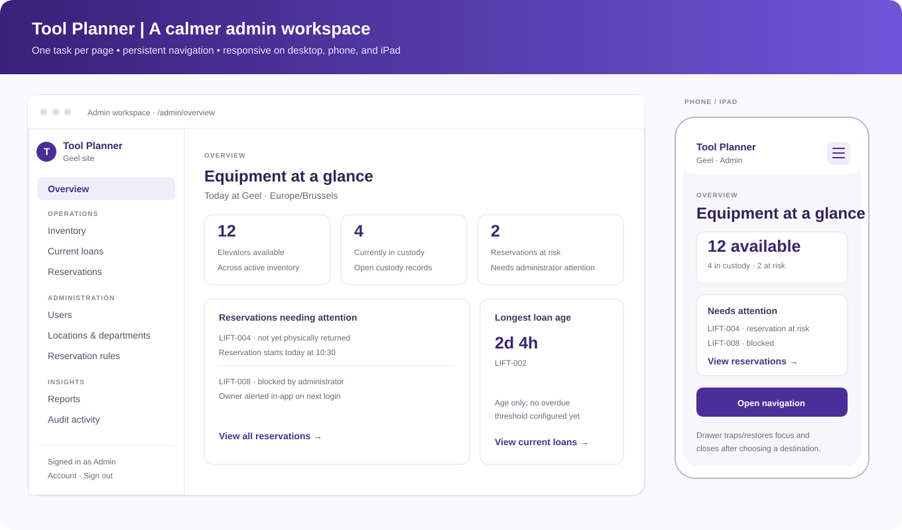

# Phase 4 — admin experience and remaining UI decisions

**Status:** Navigation proposal approved for implementation
**Implementation:** Sidebar routes, tabbed Locations & departments management,
and the aggregate Reports dashboard are implemented.

This proposal responds to the request for a dedicated sidebar with separate
management pages instead of putting every admin function on one long page. It
preserves the approved permissions and mobile support.

## Proposed admin navigation

| Navigation item | Purpose | Initial page contents |
| --- | --- | --- |
| Overview | At-a-glance operational status | Available/checked-out/blocked counts, at-risk reservations, oldest loan ages, recent alerts |
| Inventory | Elevator lifecycle and QR management | Search/filter, create/edit, current custody, QR print/rotation, block/unblock with reason, retire |
| Current loans | Outstanding custody, including administratively cancelled loans not physically returned | Borrower, elevator, location, age, status; admin-assisted return/history correction entry point |
| Reservations | Scheduling operations | Upcoming, active, cancelled, expired, and at-risk reservations; filters and reservation status details |
| Users | App-managed user accounts | Search, create account, assign role/department, set initial/reset password, disable/enable |
| Locations & departments | Site configuration | Create/edit/disable locations and departments; set exactly one default physical location |
| Reservation rules | Admin-configurable policy | Minimum notice, maximum duration, cancellation cutoff, and no-show grace, each independently editable |
| Reports | Aggregate-first usage analysis and admin exports | Date range and elevator/location/department filters, loan age, checkout counts/durations, CSV export |
| Audit activity | Accountability for privileged changes | Search/filter actors and actions; show reasons for block/unblock, administrative cancellation, correction, and export |

Keep the user-facing QR, borrow, reservation, return, and password-change flows
outside the admin navigation shell. A user who also has the `admin` role can
reach them from the QR flow without changing their role or authorization.

## Navigation and routing behavior

- Give each destination a direct URL, for example `/admin/inventory` and
  `/admin/users`. Browser refresh, back/forward navigation, and bookmarks must
  preserve the selected page.
- Show one management task at a time; the overview is a summary, not a place to
  duplicate every management form.
- On desktop/tablet, keep the sidebar in the left layout column and sticky while
  scrolling. It must not be fixed over the application header, alerts, page
  content, or footer. Use the full remaining viewport width for the page body.
- On phone widths, use a compact top bar and a button-controlled navigation
  drawer that starts below the application header. The drawer must support
  keyboard open/close, Escape, focus return, focus containment, screen-reader
  labels, and touch targets; selecting a destination closes it.
- Include a clear page title and a short description on each route. Preserve the
  existing Sanofi-inspired restrained purple palette and responsive card/table
  treatment.
- Use a router with URL-driven routes rather than a single page of conditional
  panels. Keep route guards in the frontend for UX and repeat the role check in
  the API for security.
- When a request is forbidden or the session expires, show an explicit message
  and route to sign-in; do not silently render an empty admin page.

## Page-level requirements

### Overview

- Keep the dashboard concise: essential totals, near-term reservation risk,
  and oldest outstanding loans.
- Show a compact **Currently loaned** roster by registration number, typed
  borrower name, destination/pickup location, checkout time, and loan age, with
  a link to the full Current loans page. This is limited to open custody
  records and is available to admins only.
- Do not label loans overdue until operations configures the threshold.
- Do not include completed person-level loan history on the dashboard. Historical
  personal details remain in the admin-only Reports view.

### Inventory

- Search by elevator name/registration and filter by availability, blocked/
  retired status, or physical location.
- Show current custodian independently from last-known physical location.
- Keep QR print and QR rotation as distinct actions; explain that rotation
  invalidates old labels before confirmation.
- Blocking requires a reason and explains administrative loan cancellation is
  not a physical return. Preserve the borrower as custodian until return.
- Retiring requires no outstanding custody record. Preserve historical loans.

### Users

- Search/filter by username, role, department, and active/disabled state.
- Password inputs must be masked. Initial/reset credentials require password
  change at next login; never display a stored password or hash.
- Warn before role/disable changes that would leave fewer than two active admins.
- Keep borrower-entered names distinct from the account actor on loan detail.

### Locations and departments

- Separate location and department management into accessible tabs.
- Mark one active physical location as default. Explain that changing the
  default affects new/future operations only and does not rewrite loan history.
- Allow editing names/details and deleting records from active selection.
  Deletion archives instead of removing records referenced by history; archived
  records can be restored.
- Show how many non-retired elevators or active users are assigned to each
  record. Require reassignment before archiving an in-use location or
  department, and prevent archiving the default location.
- Disabling a location/department used by history must preserve its snapshot.
- Do not let an admin delete a location that is still needed as an active
  elevator location or default without a replacement.

### Reservations and policy

- Make future time windows visible in `Europe/Brussels`.
- Show at-risk state if an active/outstanding loan or block may prevent pickup.
- Display the seven-day defaults independently. Explain that a seven-day
  minimum-notice rule plus seven-day cancellation cutoff means booking exactly
  at the minimum notice leaves no cancellation window.
- Do not automatically cancel a reservation because the elevator is late or
  blocked. Notify its owner in-app on next login and suggest available options.

### Reports and audit activity

- All admins can see person-level history and export it; user-role access must
  not expose it.
- Aggregate reports by default. Use explicit filters and date range; interpret
  and display dates in `Europe/Brussels`.
- CSV export must match visible filters, remain admin-only, be spreadsheet-safe,
  and be audited.
- Audit entries are append-only and retained under the approved three-year
  cleanup rule.
- The proposed report-dashboard values, views, and data definitions are in
  [phase-4-reports-proposal.md](phase-4-reports-proposal.md); the aggregate
  dashboard, filters, and exports are implemented.

## Remaining Phase 4 decisions and recommended defaults

These are UI/product details, not changes to the confirmed Phase 0 requirements.
The defaults below can be used unless the product owner prefers otherwise.

| Topic | Recommended default | Why it needs review |
| --- | --- | --- |
| Navigation labels/grouping | Use the nine destinations listed above, with Overview first and Users / Locations & departments grouped under Administration. | Labels should match Sanofi operations vocabulary. |
| Current loans versus inventory | Keep a dedicated Current loans page; show only a compact custody summary in Inventory. | Avoid mixing equipment attributes with person-level custody tasks. |
| Reservation management | Include a separate Reservations page and a separate Reservation rules page. | Operational bookings change often; policy changes should be less frequent and auditable. |
| Audit navigation | Provide a dedicated Audit activity page, admin-only. | Admins need a discoverable way to inspect corrections and block actions. |
| Reports defaults | Default to the last 30 days, all elevators/locations/departments, aggregated by day; offer explicit filter controls. | Implemented as an aggregate-first report without person-level details in the dashboard. |
| Inventory deletion | Retire rather than hard-delete an elevator. | Preserves loan history, QR/audit references, and registration-number uniqueness. |
| Phone navigation | Collapsible drawer controlled from the top bar; close after navigation. | Preserves screen space while retaining named destinations. |
| Route state | Store filters and date range in query parameters. | Allows sharing/bookmarking operational views without encoding personal data. |

## Phase 4 implementation acceptance criteria

1. Admin routes use a persistent desktop sidebar and a keyboard-accessible
   mobile navigation drawer; each item opens a separate URL and page.
   The desktop sidebar does not obscure the header, alerts, content, or footer.
2. The admin overview is a concise summary; it does not contain all management
   forms or expose person-level data by default.
3. Inventory, Current loans, Reservations, Users, Locations & departments,
   Reservation rules, Reports, and Audit activity are separate admin routes.
4. Direct navigation to any route enforces authentication and role checks in
   the API; expired sessions and forbidden requests show actionable messages.
5. Account password reset, two-admin protection, reservation rules, blocked
   transitions, custody invariants, privacy, and report permissions remain
   intact through the redesign.
6. Mobile/iPad and desktop layouts pass supported-browser, keyboard, screen
   reader, reflow, and contrast checks.
7. Tests cover each route's loading, empty, success, validation, forbidden,
   network failure, and stale-data behavior, plus navigation history and
   mobile drawer keyboard behavior.

## Phase 4 open work from the roadmap

The current roadmap correctly leaves these tasks open:

- Complete elevator search/filter, full edit/retire actions, and location
  editing/disable rules.
- Continue PostgreSQL query-plan validation for report aggregation as site data
  volume grows.
- Add frontend tests for borrow, reservation, return, blocked/late alerts,
  admin permissions, and inaccessible/error states.
- Verify keyboard navigation, screen-reader announcements, responsive reflow,
  and contrast on phones, iPads, and desktop admin browsers.
- Add PostgreSQL concurrency tests and auditable correction UI/API work under
  Phase 3 before declaring the full Phase 4 acceptance criteria complete.

## Review checklist

- [x] Approve the sidebar destinations, labels, and grouping.
- [x] Approve a dedicated Current loans page and separate Reservations page.
- [x] Approve the Overview and Reports recommended default date range.
- [x] Approve a dedicated Audit activity page for all admins.
- [x] Approve URL query parameters for report filters and dates.
- [ ] Validate the mobile drawer against the supported browser/device
  acceptance matrix.
