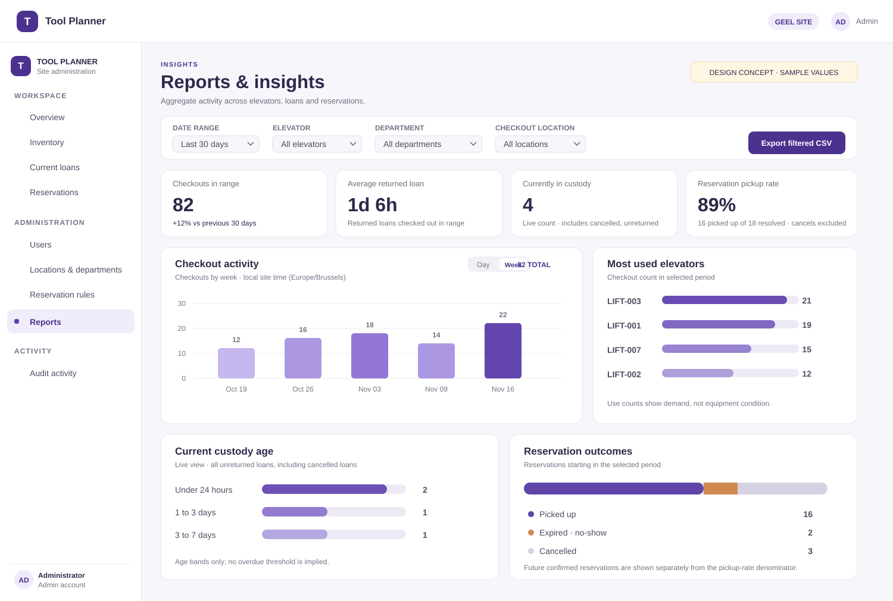
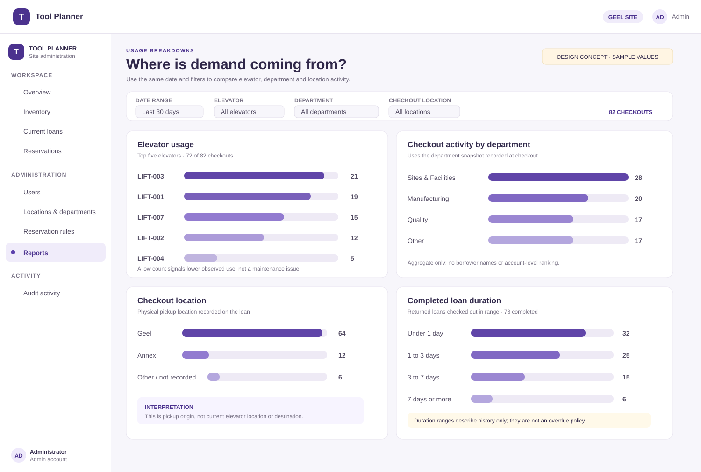

# Phase 4 — Reports and dashboard proposal

**Status:** Implemented on the Reports page and documented here as the metric
contract.

The Reports page provides an aggregate-first operational dashboard while
keeping person-level history in the separate, admin-only export.

## Visual previews

These are illustrative desktop mockups, not screenshots of live data. Sample
values are for layout review only.

### Reports overview

### Usage breakdowns

## Recommended dashboard

### 1. Shared filters

- Default the UI to the last 30 days, with daily buckets. Use weekly buckets
  for longer ranges and monthly buckets for multi-year views; allow an explicit
  day/week/month grouping switch where it remains readable. The mockup uses a weekly bucket selection
  to keep the trend legible.
- Offer a custom start/end date and optional elevator, department, and checkout
  location filters.
- Keep selected filters in URL query parameters so an admin can bookmark or
  return to a view. Do not put borrower names or other person-level data in the
  URL.
- Interpret date boundaries and chart labels in `Europe/Brussels`; convert the
  selected local range to UTC for database queries, including daylight-saving
  transitions.
- Make the data basis clear: checkout activity is based on checkout time,
  completed-loan duration uses loans checked out in the selected period, and
  reservation outcomes use reservation start time. A live custody snapshot is
  explicitly labelled as "now" and is not constrained by the date range.

### 2. At-a-glance values

| Value | Definition |
| --- | --- |
| Checkouts in range | Loans with `checked_out_at` in the selected interval. A checkout is counted once, whether or not it has since been returned. |
| Average returned-loan duration | Average `returned_at - checked_out_at` for returned loans checked out in the selected interval. Exclude still-outstanding loans and show the completed-loan count alongside the average. |
| Currently in custody | Live count of all loans without a physical return, including administratively cancelled loans. Do not call these loans overdue. |
| Reservation pickup rate | Picked-up reservations divided by picked-up plus expired no-show reservations whose `starts_at` is in the selected interval. Exclude cancelled and not-yet-resolved reservations from this denominator. If the denominator is zero, show that there is not enough completed reservation data. |

Show a prior-period comparison only when both periods have enough data. A
comparison is secondary context, not a performance target.

### 3. Useful overview panels

1. **Checkout trend:** daily or weekly checkout counts. This helps identify
   changing demand and busy periods without counting QR scans as loans.
2. **Elevator use:** checkout counts by elevator for the selected period. It
   can identify demand concentration or low observed use; it must not imply
   equipment quality or employee performance.
3. **Current custody age:** counts in descriptive bands such as under 24 hours,
   1–3 days, 3–7 days, and 7 or more days. Include cancelled-but-unreturned
   loans. These are age bands only; no band is labelled or treated as overdue
   without an operations-approved threshold.
4. **Reservation outcomes:** picked up, expired as no-show, cancelled, and
   upcoming confirmed reservations. Keep upcoming reservations separate from
   the completed-outcome pickup-rate denominator.
5. **Checkout location and department:** aggregate loan counts by the physical
   pickup location and the department snapshot recorded at checkout. Do not
   break down by free-text destination in the first version.
6. **Completed-loan duration ranges:** returned loans grouped into broad
   duration bands, complementing the average with a distribution.

## Data and privacy boundaries

- The authenticated Reports route and all report APIs remain admin-only.
- Dashboard cards, trends, and breakdowns are aggregate by default. Do not show
  borrower names, usernames, reservation owners, or individual loan rows in
  the dashboard.
- Individual history remains available only through the separately labelled
  admin CSV export, with export auditing and spreadsheet-safe values.
- Apply all supported filters consistently to displayed aggregates and the
  filtered export. Keep the existing unrestricted history export clearly
  labelled if it remains available.
- Use `department_id_snapshot` and `department_snapshot` for department
  filtering and breakdowns. Store checkout and return location name snapshots
  alongside location IDs; the migration backfills existing labels before
  dashboard reports use them.
- Reservation records do not currently store department or location. When
  either dimension is filtered, the dashboard explains that reservation
  outcomes are unavailable rather than showing unfiltered reservation values.
- Data remains subject to the approved three-year cleanup. Reports must not
  reconstruct or expose data after its retention eligibility.

## Implemented behavior

The Reports page now provides the shared date/elevator/department/location
filters, URL-backed state, day/week/month trend buckets, summary metrics,
checkout trend, elevator usage, live custody-age bands, reservation outcomes,
department and pickup-location breakdowns, and completed-loan duration bands.
The charts retain readable labels and values and use responsive layouts.

The admin API aggregates loans in SQL and interprets date boundaries in
`Europe/Brussels`, including daylight-saving transitions. The filtered CSV
uses the same date and dimension filters and is audited; a separate
all-retained-history export remains clearly labelled. The migration adds
department and location name snapshots and backfills existing loans. If
department or pickup-location filters are selected, the reservation panel is
replaced with an explanation because reservations do not capture those fields.

The API limits filtered date ranges to three years, matching the retained
history horizon. Trends use database hourly aggregates before converting to
local day/week/month groups, rather than loading individual loan records into
application memory. Query plans should still be reviewed as site data volume
grows.

## Delivered safeguards and tests

- Aggregate responses contain no borrower names or user identities.
- All report and export routes are admin-only; CSV text fields are protected
  against spreadsheet-formula injection and export actions are audited.
- Current age bands include administratively cancelled loans that have not
  physically returned, without labelling any loan overdue.
- Backend tests cover role restrictions, Brussels-local date grouping across
  the daylight-saving boundary, dimension filters, historical location labels,
  cancelled outstanding custody, the reservation pickup-rate denominator,
  invalid ranges, and filtered/all-history export behavior.
- Frontend tests cover dashboard rendering and filter-to-export query state.

The visual previews above remain the design reference; their sample numbers are
illustrative, while the implemented page uses live aggregate data.
