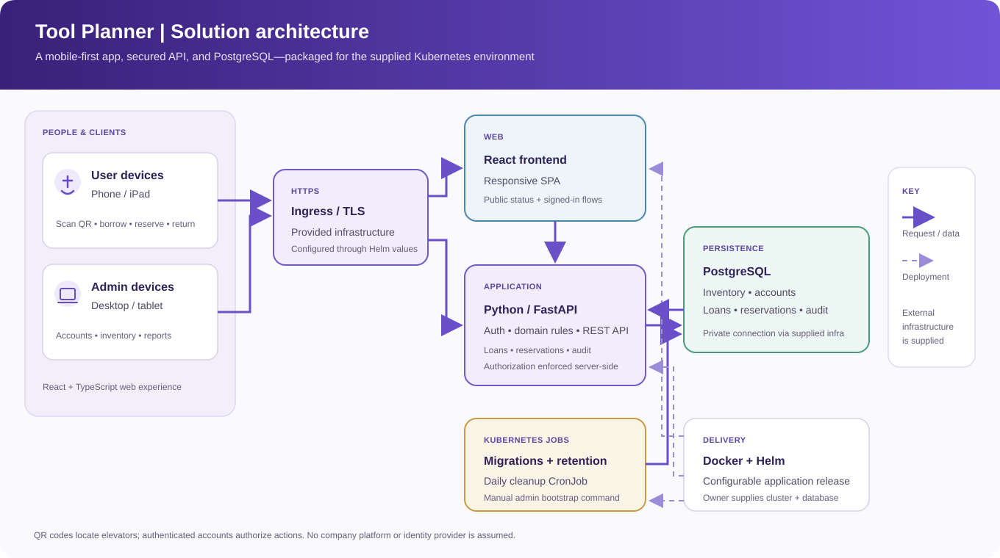
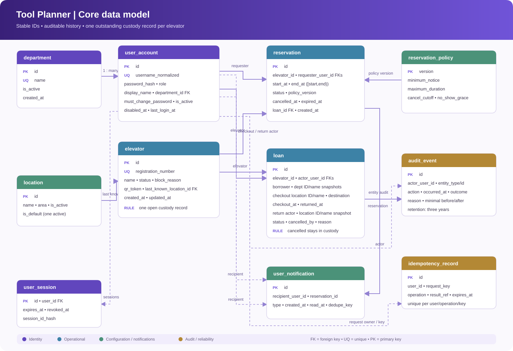

# Phase 1 — solution design

**Status:** Design draft ready for review

**Implementation:** Initial foundation, core flows, and aggregate report
dashboard implemented; remaining verification and features are tracked in
[roadmap](roadmap.md).
**Scope source:** [Product analysis](README.md), [confirmed decisions](open-questions.md)

This document turns the approved Phase 0 requirements into a proposed
implementation design. Approve this design before starting Phase 2 (repository
and developer foundation). It is not a record of code already implemented.

## 1. Design summary

- **Frontend:** React and TypeScript, mobile-first for phones and iPads.
- **API:** Python and FastAPI, with Pydantic request/response validation.
- **Persistence:** PostgreSQL, SQLAlchemy 2.x, and Alembic migrations.
- **Authentication:** Local username/password accounts with `user` and `admin`
  roles; no external identity provider.
- **Deployment:** Docker image build(s) and a Helm chart configured for the
  infrastructure supplied by the product owner. PostgreSQL is provisioned
  outside the application chart and supplied by configuration.
- **Time:** Store timestamps as UTC instants; accept and display reservation
  times in `Europe/Brussels`.

The backend owns authorization and all state transitions. The frontend is not
trusted to enforce access, availability, reservation conflicts, or retention.

## 2. Component and request flow

The QR URL is a public locator for an elevator. It may show basic status without
revealing borrower details. Login is required before borrowing, returning,
reserving, or using admin functions. The QR token grants no account or role
privileges.

Keep the initial deployment single-site and single-origin where practical.
Terminate TLS at the supplied ingress; keep PostgreSQL private to the
application network.

## 3. Backend boundaries

Keep these responsibilities separate:

- **HTTP/API layer:** routing, authentication dependency, request validation,
  response serialization, and mapping known domain conflicts to HTTP errors.
- **Application services:** checkout, return, reservation, block/unblock,
  cancellation, account administration, reporting, and retention operations.
- **Domain rules:** allowed state transitions, availability decisions, policy
  validation, and report semantics. Do not put these rules only in React or
  route handlers.
- **Persistence:** SQLAlchemy repositories/models, PostgreSQL constraints, and
  Alembic migrations.
- **Jobs/CLI:** daily data retention and the manually run initial-admin
  bootstrap command. Jobs call the same application services as the API where
  appropriate.

Use explicit request/response schemas and typed service interfaces. Return a
stable error object with a machine-readable code, human-readable message, and
request ID. Do not return stack traces or database details to the browser.

### Query and response conventions

- Keep all routes under `/api/v1`; introduce incompatible changes under a new
  major path rather than silently changing response fields.
- List endpoints use cursor pagination with a default page size of 50 and a
  maximum of 200. Cursors are opaque; use stable ordering by timestamp and ID.
- Accept only allowlisted sort fields and documented filters. Inventory filters
  include status, location, and registration/name search. History filters
  include date range, elevator, location, and department.
- Return ISO-8601 timestamps in UTC with `Z`; the frontend converts them to
  `Europe/Brussels`.
- A typical error response is
  `{"code":"elevator_unavailable","message":"This elevator is not available.","request_id":"..."}`.
  Keep messages safe for users and use `code` for client behavior.

## 4. Proposed relational model

Use UUID primary keys and UTC timestamps. Registration number, username, and QR
token are separately unique; do not expose sequential IDs in public QR URLs.

| Table | Important fields and rules |
| --- | --- |
| `user_account` | `id`, normalized unique `username`, `password_hash`, `role` (`user`/`admin`), `display_name`, `department_id`, `is_active`, `must_change_password`, `created_at`, `disabled_at`, `last_login_at` |
| `user_session` | Hashed opaque session ID, `user_id`, created/expiry/revocation timestamps; supports revocation and multiple API replicas without storing session state in process memory |
| `department` | `id`, unique `name`, `is_active`; seed `Sites & Facilities` |
| `location` | `id`, `name`, optional area/details, `is_active`, `is_default`; seed `Geel` as default |
| `elevator` | `id`, unique `registration_number`, `name`, `status` (`active`/`blocked`/`retired`), `block_reason`, opaque unique `qr_token`, `last_known_location_id`, timestamps; seed name/registration `LIFT-001` |
| `loan` | `id`, `elevator_id`, authenticated checkout actor, typed borrower name, department ID/name snapshots, checkout location ID/name snapshot, destination/details, `checked_out_at`, return actor/time/location ID/name snapshot, status (`active`/`cancelled`/`returned`), cancellation actor/time/reason |
| `reservation` | `id`, `elevator_id`, requester account, borrower-name snapshot, requested `[start,end)` instants, status (`confirmed`/`cancelled`/`expired`/`picked_up`), created/cancelled/expired timestamps, linked loan, policy snapshot |
| `reservation_policy` | Admin-managed values for minimum notice, maximum duration, cancellation cutoff, and no-show grace; increment a version on change |
| `audit_event` | Actor (nullable for system jobs), action, entity type/ID, timestamp, outcome, reason, and minimal before/after metadata |
| `user_notification` | Recipient, related reservation/elevator, notification type, created/read timestamps, unique deduplication key |
| `idempotency_record` | User/request key, operation, stored result reference, expiry; prevents duplicate submissions on client retry |

`LIFT-001` is the supplied registration/name seed; admins may edit the display
name later without changing the unique registration number.

### Location and custody

- Keep physical location independent of borrower/custodian.
- Exactly one active location is the default. Changing the default affects
  future operations only; it does not rewrite loan history.
- The checkout row stores the pickup location and the user's stated destination.
  Store its location name as a snapshot as well as the stable location ID, so
  historical reports and exports remain unchanged after a location is renamed.
  The elevator's last-known location can be updated from that destination, but
  this is user-supplied information, not live tracking.
- Return stores the actual return location; if none is selected, use the
  configured default `Geel`, including a historical name snapshot. "Site"
  remains the available-custodian label and is not a person or location record.

### Database invariants

Enforce these in PostgreSQL as well as in service validation:

1. A partial unique index on `loan(elevator_id)` where `returned_at IS NULL`
   permits at most one outstanding custody record per elevator. A loan
   administratively cancelled by a block remains outstanding until it is
   physically returned.
2. A returned loan must have `returned_at`; a cancelled loan must have
   `cancelled_at`, `cancelled_by`, and a non-empty reason. A cancelled
   outstanding loan may later transition to returned while retaining its
   cancellation metadata.
3. A partial unique index permits only one active default location.
4. Reservation intervals are half-open (`[start,end)`) and must have
   `start < end`. Confirmed reservations for the same elevator must not
   overlap. Use a PostgreSQL exclusion constraint on the elevator and
   `tstzrange`; if the supplied database does not permit the required
   `btree_gist` extension, use a transaction-safe per-elevator lock plus
   overlap check instead.
5. Active loans may overlap future reservations by explicit product decision.
   The late-return alert/alternative flow covers this risk; do not pretend a
   future reservation guarantees the current borrower has returned the item.
6. User/account deletion must not cascade-delete audit or unexpired loan
   history. Store the required snapshots and apply the three-year cleanup rules.

Add indexes for normalized username, elevator registration/status/location,
loan checkout/return time, reservation elevator/time range, audit entity/time,
and notification recipient/unread state. Add a partial index for outstanding
custody and a unique partial index for the configured default location.

## 5. State transitions

### Loan and custody

| Current state | Event | Next state | Required behavior |
| --- | --- | --- | --- |
| None | Authenticated checkout of an active, unblocked elevator | `active` | Lock/check availability transactionally; snapshot borrower, department, pickup, and destination |
| `active` | Authenticated user returns | `returned` | Record actual return actor, time, and location; update last-known location |
| `active` | Admin blocks the elevator | `cancelled` | Record admin, time, and reason; keep borrower as custodian and keep the outstanding-custody constraint until actual return |
| `cancelled` | User scans QR and records actual return | `returned` | Preserve cancellation metadata and record real return data |
| `returned` | Duplicate return attempt | No transition | Return a conflict; do not change history |

An elevator marked blocked or retired cannot be checked out or newly reserved.
Unblocking does not close an outstanding custody record; a new checkout remains
forbidden until the actual return is recorded.

### Reservation

| Current state | Event | Next state | Required behavior |
| --- | --- | --- | --- |
| None | Authenticated user confirms an available time window | `confirmed` | Validate policy and non-overlap transactionally; active loans are allowed |
| `confirmed` | Requester cancels before configured cutoff | `cancelled` | Record who and when; retain the event for history |
| `confirmed` | User picks up at the elevator | `picked_up` | Create/link an active loan in the same transaction |
| `confirmed` | No pickup by start plus configured grace | `expired` | Record expiry; do not create a loan |

Initial configurable values are seven days each: minimum notice, maximum
reservation duration, cancellation cutoff before start, and no-show grace after
start. These are separate admin settings. With both minimum notice and
cancellation cutoff set to seven days, a booking made exactly at the minimum
notice cannot be cancelled; show this before confirmation.

Recommended no-show rule for review: only count grace time while the elevator is
actually available for pickup. If an outstanding loan or block makes pickup
impossible, do not expire the reservation as a no-show; notify the user and
leave it for the user/admin to resolve. This avoids treating an unavailable
elevator as a user no-show.

When a reservation begins and its elevator still has outstanding custody, or
the elevator has been blocked, create a deduplicated in-app notification for
the reservation owner. On next login, show the alert and alternatives available
for the requested time window. If none are available, state that the reserved
elevator is not available. Do not silently substitute or cancel the
reservation. Email notification is a later enhancement, not an initial
dependency.

## 6. API contract outline

Prefix endpoints with `/api/v1`. All state-changing routes require a valid
authenticated session and CSRF protection when cookie-based sessions are used.
Every admin route checks the `admin` role server-side.

| Endpoint | Access | Purpose |
| --- | --- | --- |
| `GET /qr/{token}` | Public, rate-limited | Basic elevator name/registration and availability only; no personal details |
| `POST /auth/login` | Public, rate-limited | Establish local account session; return `must_change_password` state |
| `POST /auth/logout` | Authenticated | Revoke session |
| `POST /auth/change-password` | Authenticated | Complete required first-login password change |
| `GET /me` | Authenticated | Return own account display name, role, department, and password-change requirement |
| `GET /me/notifications` | Authenticated | Reconcile late/blocked reservations, then fetch unread alerts |
| `POST /qr/{token}/checkout` | User/admin | Checkout; request includes borrower display name, department, pickup/destination fields |
| `POST /qr/{token}/return` | User/admin | Return the outstanding custody record; valid for `active` and administratively `cancelled` loans |
| `POST /qr/{token}/reservations` | User/admin | Create a future reservation |
| `POST /reservations/{id}/cancel` | Requester/admin | Cancel within configured cutoff |
| `GET /admin/users` / `POST /admin/users` | Admin | List/create accounts with initial password and role |
| `PATCH /admin/users/{id}` | Admin | Change display name, department, role, or active status; audit changes |
| `POST /admin/users/{id}/reset-password` | Admin | Assign a new initial password and require reset at next login |
| `GET/POST/PATCH /admin/elevators` | Admin | Inventory management and status changes |
| `POST /admin/elevators/{id}/block` | Admin | Require reason; cancel an outstanding active loan and notify future reservation owners |
| `POST /admin/elevators/{id}/unblock` | Admin | Require reason; keep any outstanding custody record open |
| `GET/PATCH /admin/reservation-settings` | Admin | Read/update each reservation time limit independently |
| `GET/POST /admin/locations`, `/admin/departments` | Admin | Manage site configuration and default location |
| `GET /admin/reports/dashboard` | Admin | Aggregate reports filtered by Brussels-local dates, elevator, department, location, and trend bucket |
| `GET /admin/reports/loans.csv`, `/admin/reports/loans-all.csv` | Admin | Export filtered loan history or all retained history; each export is audited |
| `GET /admin/reports/*` | Admin | Inventory, active custody, reservations, and loan-history reports/exports |

Use consistent HTTP semantics: `401` unauthenticated, `403` role denied, `404`
unknown resource/token, `409` stale state/availability/overlap conflict, and
`422` invalid fields or policy violation. Error responses include a stable code
and request ID. Never return another user's identity from the public QR
endpoint.

## 7. User interface and authorization

The approved admin navigation and remaining Phase 4 UI work are documented in
[phase-4-admin-ia.md](phase-4-admin-ia.md).

- **QR status page:** elevator identification, clear available/checked-out/
  blocked/retired state, and sign-in entry. No borrower PII.
- **Borrow:** after login, immediate checkout is the default. Form captures the
  typed borrower name, department, pickup/current location, and destination.
  Show the elevator and borrower before final confirmation.
- **Reserve:** choose a future start/end in Brussels local time; show the
  seven-day rules and cancellation cutoff before confirmation. Explain that
  reservations can be affected by an active loan and show the alternative
  process.
- **Return:** same QR code; any signed-in user can return. Clearly distinguish
  a cancelled-but-still-outstanding loan from an actual return.
- **Alerts:** show unread affected-reservation alerts on next login. If no
  alternative is available, show the explicit "not available" message.
- **Admin:** user/account management, elevator inventory and QR print/rotation,
  location/department configuration, default location, reservation settings,
  blocked/unblocked actions with required reason, reports, and exports.

Only admins see individual borrower history or person-level exports. All
reports are admin-only and default to aggregates; users see only their own
reservation/notification details and public elevator status.

## 8. Reporting semantics

The admin Reports page uses the aggregate-first dashboard described in
[phase-4-reports-proposal.md](phase-4-reports-proposal.md). Its API accepts
`start_date`, `end_date`, `elevator_id`, `department_id`, `location_id`, and a
day/week/month trend bucket. Dates are interpreted as site-local calendar days
in `Europe/Brussels`, converted to UTC half-open query bounds, and limited to a
maximum three-year range. The default UI range is the last 30 days. Filters
are URL-backed and contain no person-level data.

The dashboard aggregates in SQL; hourly aggregate buckets are converted to
local day/week/month labels so daylight-saving transitions are handled without
grouping individual loan rows in application memory. The reservation outcome
panel uses date and elevator filters only. It is omitted with a clear note when
department or pickup-location filters are selected because reservations do not
store those dimensions.

- **Current inventory:** available, checked out (including cancelled but not
  returned custody), blocked, retired, and last-known location.
- **Current custody:** borrower snapshot, authenticated checkout actor,
  department, location/destination, checkout time, and loan age. Admin-only.
- **Upcoming reservations:** elevator, time window, requester, state, and
  at-risk flag when an outstanding loan or block may prevent pickup. Admin-only
  person-level details.
- **History:** count and duration by elevator, department, location, and time
  period. Checkout count uses completed and currently outstanding checkouts in
  the selected period; duration statistics use only loans with actual return
  times. Median/total durations use actual checkout-to-return elapsed time.
- **Peak demand:** count of checkout starts grouped by local day-of-week and
  hour in `Europe/Brussels`; report the selected date range and included
  population.
- **Exports:** the filtered CSV follows the dashboard date/elevator/department/
  location filters; a separately labelled all-retained-history CSV remains
  available to admins. Record export actor/time in the audit log. Escape
  spreadsheet-formula prefixes in exported text fields.
- Do not label a loan overdue until operations later configures an overdue
  threshold. Store/report loan age without an overdue classification.

## 9. Authentication, audit, and security design

- Store passwords using Argon2id with a maintained password-hashing library and
  parameters appropriate to the deployment. Never log passwords or return a
  stored hash.
- Admin-assigned passwords are initial credentials; `must_change_password`
  blocks other application actions until changed.
- Use server-side sessions in `Secure`, `HttpOnly`, `SameSite` cookies, CSRF
  protection on writes, login rate limits, generic login errors, and session
  revocation on password reset/account disablement.
- When a protected API request returns `401`, clear the client account and
  redirect to `/login`; an invalid login remains on that page with its error.
- Do not allow role changes or account disablement to reduce active admins
  below two. Audit user creation, resets, role changes, disablement, block/
  unblock, loan cancellation, return corrections, and exports.
- The manual bootstrap command prompts for credentials without echoing them,
  hashes them before storage, sets forced password change, and refuses to
  silently overwrite existing accounts. Run it against the configured database
  only when explicitly invoked by the infrastructure owner.
- Keep secrets in the supplied secret-management mechanism, outside Git and
  container images. Use least-privilege database credentials and non-root
  containers.
- Public QR status endpoints are rate-limited and return no personal data.
  Authorization is checked on every API request, never just in the React UI.

### Threats and mitigations

| Threat | Mitigation |
| --- | --- |
| Guessing or copying a QR URL | High-entropy random token, rate-limited public status endpoint, no PII or privileged action on token alone, admin token rotation |
| Password guessing or credential disclosure | Argon2id, generic login errors, rate limits, secure transport, hidden password prompts, no plaintext logging |
| User accessing admin APIs or person-level exports | Server-side role checks on every route; tests cover both UI and direct API requests |
| Duplicate checkout/reservation under races or retries | PostgreSQL constraints/transactions, per-operation idempotency, conflict responses |
| Accidental or unauthorized loan cancellation/block | Admin-only action, required reason, immutable audit event, explicit cancellation state |
| PII exposure in logs, QR page, or exports | Public response allowlist, structured-log redaction, admin-only detail/export, spreadsheet-safe CSV |
| Cleanup failure or old data returning after restore | Observable scheduled job, alert on failure, restore-before-access cleanup gate, independent backup lifecycle |

### Privacy and accessibility

- Collect only the typed borrower name, department, destination/location, and
  account fields needed for operations and approved reporting.
- Never display another user's name, department, or loan history on a public QR
  page.
- Make person-level reports admin-only; aggregate reports by default.
- Target WCAG 2.2 AA for the responsive web UI. Verify keyboard operation,
  visible focus, labels/errors, screen-reader status announcements, zoom/reflow,
  and sufficient contrast. Status must not be conveyed by color alone.

## 10. Retention and operations

Package the cleanup as a Kubernetes `CronJob`, daily and configurable in Helm.
The cleanup service:

1. Deletes returned loans and completed/cancelled/expired reservations after
   their three-year retention period.
2. Deletes audit events older than three years.
3. Deletes disabled account details after three years disabled only when no
   outstanding custody record or unfulfilled reservation needs them.
4. Never deletes active/outstanding custody or unfulfilled reservations.
5. Logs counts and failures without logging unnecessary personal details;
   retries safely and exposes job success/failure to monitoring.

Backups can contain expired data until their configured backup lifecycle ends.
After a database restore, run the cleanup successfully before exposing the
application to users. Backup expiry itself belongs to the supplied
infrastructure.

Use `Europe/Brussels` for UI, schedules, and report grouping; persist UTC.
Handle daylight-saving gaps/overlaps explicitly when validating local
reservation times. A local time that maps to two instants must be disambiguated
in the UI; a nonexistent local time must be rejected with a clear message.

## 11. Docker and Helm contract

Provide non-root Docker image builds for the Python API and React frontend.
Keep builds reproducible and do not bake credentials or environment-specific
URLs into images.

The Helm chart should expose, at minimum:

- API/frontend image repository and tag, replicas, service ports, resources,
  probes, and pod/container security context.
- Nginx DNS resolver for the Kubernetes cluster so API service IP changes are
  picked up without rebuilding the web image.
- Ingress enablement, host, class, annotations, and TLS secret reference.
- Application origin, `Europe/Brussels`, and retention CronJob schedule/time
  zone.
- PostgreSQL connection through an existing secret reference; no database
  password in Helm values committed to Git.
- Existing secret references for session/signing keys and other secrets.
- Migration job settings and retention job enablement/schedule.

The chart deploys the application workloads and jobs; it does not assume a
company platform or install PostgreSQL. The product owner supplies the cluster,
database, ingress, secrets facility, backup lifecycle, and their connection
values. Document the manual admin bootstrap invocation against the deployed API
image without placing passwords in shell history.

## 12. Test and acceptance strategy

Tests are required at each layer; use PostgreSQL integration tests for database
constraints and concurrency behavior rather than relying only on SQLite.

- **Domain/unit:** all allowed/denied state transitions, seven-day reservation
  rules, DST handling, block cancellation without false return, and retention
  cutoff boundaries.
- **PostgreSQL integration:** outstanding custody partial unique index,
  exclusion/locking behavior for overlapping reservations, one-default-location
  constraint, transaction rollback, and returned/cancelled checks.
- **API/auth:** user/admin role matrix; password change required on first
  login; disabled account/session revocation; any user can return; admin-only
  user management, person-level reports, and exports.
- **Concurrency:** simultaneous checkouts yield one custody record; competing
  reservation windows cannot both commit; repeated requests are idempotent.
- **Retention job:** eligible rows are deleted, ineligible active/open rows are
  preserved, repeated runs are safe, and failures are observable.
- **Frontend/E2E:** QR flow, login, borrow, future reserve, late/blocked alerts,
  unavailable-without-alternatives message, cancelled-loan return, and admin
  management flows.
- **Device matrix:** current and previous major iOS/iPadOS Safari; current and
  previous major Android Chrome; current and previous Chrome, Edge, and Safari
  on desktop admin browsers. Validate portrait/landscape, keyboard access, and
  readable status without relying on color alone.
- **Admin bootstrap:** run the separate command-line script against a disposable
  PostgreSQL database; verify two admins are created, plaintext passwords are
  absent from storage/logs, and both accounts are forced to change passwords.
- **Deployment:** build images, render/lint Helm templates with representative
  values, verify secret references, run migrations, exercise readiness/liveness,
  run the retention job, and complete a restore-before-access rehearsal.

## 13. Phase 1 review checklist

- [ ] Approve the schema/state model, especially cancelled-but-outstanding
  custody.
- [ ] Approve the API outline and role/permission matrix.
- [ ] Approve local authentication/security choices and bootstrap behavior.
- [ ] Approve reservation timing behavior and its seven-day cancellation
  consequence, including the recommended no-show grace handling when the
  elevator is blocked or still on loan.
- [ ] Approve the external PostgreSQL and configurable Helm deployment contract.
- [ ] Approve the test strategy and browser matrix.
